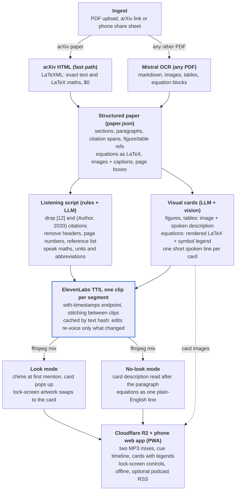

# Paper-to-Audio Pipeline — Design
 
31 Oct 2026 · Jan
 
## Goals & scope
 
The pipeline turns a research PDF into a phone-friendly audio episode that sounds like a narrated paper, not a raw text dump. It must:
 
- Strip citation markers ([12], [3–5], (Smith et al., 2020)) and boilerplate: running headers, page numbers, the reference list.
- Speak maths and tables in a listenable way instead of reading symbols aloud.
- Offer two listening modes from **one** TTS render: **Look** — a short cue plays and the figure pops up in the player at that second; **No-look** — a short spoken description of each figure or table is inserted instead.
- Let you open any figure or table on the phone while listening.
Assumptions from your answers: English, born-digital papers (arXiv, IEEE, Springer), cloud APIs rather than self-hosted models, ElevenLabs for speech. Scanned PDFs and Polish voices are out of scope for v1, but nothing in the design blocks them later.
 
## Pipeline overview
 

 
One ElevenLabs render feeds both listening modes. A paper flows top to bottom. Each stage writes a file the next one reads (`paper.json` → script and cards → audio clips → two mixes + a cue timeline), so any stage can be re-run on its own after a fix.
 
## Stage 1 — Ingest & parse
 
Try arXiv's HTML version first and fall back to Mistral OCR for everything else. Both write the same `paper.json`, so later stages never care where the text came from.
 
- **arXiv fast path ($0).** Most arXiv papers have an HTML version generated from the LaTeX source by LaTeXML, linked from the abstract page ([arXiv](https://info.arxiv.org/about/accessible_HTML.html)). You get exact text, real citation markers, figure and table labels, and every equation as LaTeX, with no OCR errors. Constructs LaTeXML cannot convert show up as red error markup; when a paper has them, fall back to OCR.
- **Any other PDF → Mistral OCR** (`mistral-ocr-latest`). It returns markdown per page, the embedded images, and tables as markdown or HTML. From OCR 4 it can also return reading-order blocks typed `equation`, `table`, `image`, `caption` and `references`, each with a bounding box ([Mistral docs](https://docs.mistral.ai/capabilities/document_ai/basic_ocr/)) — exactly the parts the next stages need. Billed per 1,000 pages, with 50% off through the Batch API ([pricing](https://mistral.ai/pricing)); roughly 1–3 cents for a 10-page paper.
- **Optional cross-check: GROBID** (free, runs in Docker). Its TEI output tags in-text citations and figure, table and formula references, with PDF coordinates ([GROBID docs](https://grobid.readthedocs.io/en/latest/Coordinates-in-PDF/)). Worth adding later if citation stripping misses cases in IEEE-style papers; skip it in v1.
`paper.json` holds: sections → paragraphs, each with its citation spans and the figure, table and equation labels it mentions; a list of visuals (image file, caption, label, page box); and display equations as LaTeX with their number.
 
## Stage 2 — Clean-up for listening
 
Strip citations in two passes: deterministic rules first, then an LLM that only repairs the sentences the deletions broke. The LLM must not summarise or paraphrase — you want the paper, not a retelling.
 
| In the paper | Rule | You hear |
| --- | --- | --- |
| “…is robust [3, 7–9].” | delete numeric citation | “…is robust.” |
| “as shown in [12]” | delete, then repair | “as shown in earlier work” |
| “[7] proposed a filter…” | citation as subject → rewrite | “One earlier study proposed a filter…” |
| “Smith et al. [7] showed” | keep the name, drop the number | “Smith and colleagues showed” |
| “(Lee and Park, 2021; Doe, 2019)” | delete author–year group | — |
| “Fig. 3(b)”, “Tab. II”, “Eq. (4)” | expand labels | “Figure 3 b”, “Table 2”, “Equation 4” |
| “e.g.”, “i.e.”, “w.r.t.”, “SOTA” | expand | “for example”, “that is”, “with respect to”, “state of the art” |
| “3.2 ms”, “1e-4”, “±0.3”, “∼40” | speak units and numbers | “3.2 milliseconds”, “ten to the minus four”, “plus or minus 0.3”, “about 40” |
| inline maths “α = 0.5” | read as words | “alpha equals 0.5” |
| headers, page and line numbers, footnote marks, URLs, arXiv side stamp | remove | — |
| references, acknowledgements | drop; appendix becomes an optional chapter | — |
 
Rules that keep this safe:
 
- **Use structure before regex.** On the arXiv path citations are already marked; on the OCR path, match only numbers that exist in the reference list. A bare regex for `[0, 1]` would also delete a maths interval, so never run it inside equation spans.
- **One LLM call per section** (Claude Haiku 5.5 or Sonnet 5.5) with the rules above, returning text plus anchor tags like `{fig:3}` and `{eq:4}` where visuals are mentioned.
- **Guard against rewriting.** Diff the LLM output against the input; if more than ~5% of words changed outside citation spans, flag the paragraph and keep the rule-based version.
## Stage 3 — Visual cards: figures, tables, equations
 
Every figure, table and display equation becomes a **card**: the visual for the screen plus a short spoken version for the ear. Both listening modes are then cut from the same audio clips.
 
| Card | On screen | Spoken in No-look mode | Built by |
| --- | --- | --- | --- |
| Figure | cropped image + caption, pinch to zoom | 2–4 sentences: chart type, axes, the trend the authors point to | Claude Sonnet 5.5 with the image, caption and the paragraphs that cite it |
| Table | rendered table, the winning cells highlighted | the takeaway, never every cell: “the proposed method wins on 4 of 5 datasets” | same |
| Equation | rendered LaTeX + symbol legend | one plain-English line of what it computes | Claude with the LaTeX + the paper's text |
 
### Equation cards with a symbol legend
 
The card shows the equation rendered (KaTeX) with a legend underneath; tapping a symbol highlights its row. For example, a card for a VAE loss:
 
$$
\mathcal{L} = \mathcal{L}_{\mathrm{rec}} + \beta \, D_{\mathrm{KL}}\big(q_\phi(z \mid x) \,\|\, p(z)\big)
$$
 
| Symbol | Meaning | Defined in |
| --- | --- | --- |
| ℒ | total training loss | Sec. 3 |
| ℒ_rec | reconstruction loss of the decoder | Sec. 3.1 |
| β | weight of the KL term (set to 4) | Sec. 4.2 |
| q_φ(z \| x) | encoder's distribution over latent z, parameters φ | Sec. 3.1 |
| p(z) | prior over z, standard normal | *inferred* |
 
How it is built:
 
1. **Detect** display equations: LaTeX on the arXiv path, `equation` blocks from Mistral OCR otherwise.
2. **Keep a paper-wide glossary.** Walk the paper in order and record each “where x is…” definition, so a symbol defined in Section 2 is still explained in Section 5.
3. **Write the legend** with one LLM call per equation (LaTeX + glossary + the paragraph around it), returning symbol, meaning, unit or shape, and where it was defined. Anything not defined in the paper is marked *inferred* and shown in grey, so a guess never looks like a fact.
4. **Write the spoken line**: “Equation 4: the total loss is the reconstruction loss plus beta times the KL divergence between the encoder's distribution and the prior.” Short equations (under ~15 symbols) can also be read verbatim as an option.
### Where cues and descriptions go
 
- **Look mode:** at the first mention of a visual, a soft chime plays at the end of that sentence and the card opens in the player at that second. Later mentions just re-highlight the card, no chime.
- **No-look mode:** the spoken version plays after the paragraph with the first mention, never mid-sentence. A visual the text never mentions goes at the end of its section.
- **Segments, not two renders.** The script is a list of segments — `text`, `cue`, `desc`. Look = text + cue; No-look = text + desc. Each segment is voiced once, so No-look costs only the extra description characters (about 10%).
## Stage 4 — Text-to-speech with ElevenLabs
 
Use Eleven v4 (or Multilingual v2) for papers you will actually listen to, and Flash v2.5 for test runs at half the price. Voice every segment through the timestamps endpoint so the player knows the exact second each figure or equation is mentioned.
 
| Model | API price per 1K characters | Max characters per request |
| --- | --- | --- |
| Eleven v4 | $0.08 | 10,000 |
| Eleven v3 | $0.08 | 5,000 |
| Multilingual v2 | $0.08 | 10,000 |
| v4 Turbo | $0.04 | not listed |
| Flash v2.5 | $0.04 | 40,000 |
 
Prices from [ElevenLabs API pricing](https://elevenlabs.io/pricing/api); limits from the [models page](https://elevenlabs.io/docs/overview/models). The API page implies about 1,000 characters per minute of audio.
 
- **Endpoint:** `POST /v1/text-to-speech/{voice_id}/with-timestamps` returns the audio plus start and end times for every character ([docs](https://elevenlabs.io/docs/api-reference/text-to-speech/convert-with-timestamps)). Find the `{fig:3}` anchor's character offset and you have the cue's timestamp; the same data drives a karaoke-style transcript.
- **Segment size:** one request per paragraph (up to ~2,500 characters), far under every limit. Small segments make retries, caching and partial fixes cheap.
- **Continuity:** pass `previous_text` / `next_text`, or up to 3 `previous_request_ids`, so intonation flows across segments. Keep the same model and voice for a whole paper, and leave logging on if you use request IDs.
- **Pronunciation:** attach up to 3 pronunciation dictionaries per request. Keep one team dictionary for terms like LiDAR, SLAM, ROS 2, IMU, URDF and author names.
- **Cache:** key each clip on a hash of (model, voice, settings, text). Fixing one paragraph re-voices only that paragraph.
- **Voices:** a calm narrator for the paper and a second voice for card descriptions, so you can hear when the audio is describing a figure rather than reading the authors' words.
- **Speed:** render at normal speed and let the player speed it up; re-rendering for speed wastes characters.
## Hosting & listening app
 
Your web-app idea is the right one: build it as a **PWA** (installable web app) so it sits on the phone's home screen, plays with the screen locked and works offline. Add a private podcast feed as a second way in for the car and long walks.
 
| Piece | Choice | Why |
| --- | --- | --- |
| App | SvelteKit or Next.js PWA on Cloudflare Pages | home-screen install, service worker caches episodes for offline |
| Player | HTML audio + Media Session API | lock-screen and headphone controls, ±15 s skips; the lock-screen artwork swaps to the current card |
| Pipeline worker | Python (FastAPI + a job queue) in Docker on a small VM or a lab server | parsing libraries are Python; the heavy work runs in APIs, so one small CPU is enough |
| Files | Cloudflare R2 | $0.015 per GB-month, 10 GB free, no egress fees ([R2 pricing](https://developers.cloudflare.com/r2/pricing/)) |
| Data + login | Supabase (Postgres + auth), or SQLite behind Cloudflare Access for a single user | library, playback positions, team sharing |
| Second way in | private podcast RSS with chapters | play in any podcast app, CarPlay or Android Auto |
 
**The player screen**, top to bottom:
 
1. Paper title and a chapter list (Abstract, Method, Results…) with “skip related work” and “skip appendix” toggles.
2. **The card area**: the current figure, table or equation slides in when it is mentioned; swipe through all cards, tap to zoom.
3. Transcript with the current sentence highlighted; tap any sentence to jump there.
4. Controls: play, speed (0.8–2×), ±15 s, and a **Look / No-look** switch. The timeline file stores segment offsets for both mixes, so switching keeps your place in the paper.
Test background playback on an iPhone early: home-screen web apps have had quirks with audio in the background. If it misbehaves, the podcast feed covers long listening sessions.
 
## Cost per paper
 
A typical 10-page conference paper costs **about $3.50** with the best voice and model, or **about $1.60** on a budget. Speech is about 90% of the bill, so spend on the voice and use the better LLM everywhere — it adds only ~$0.30.
 
Assumed paper: ~36,000 characters of body text + ~4,000 of card descriptions = 40,000 characters (~40 minutes of audio), 6 figures and tables, 10 display equations.
 
| Step | Quality setup | Budget setup |
| --- | --- | --- |
| Parse — Mistral OCR, 10 pages (arXiv HTML is free) | ~$0.02 | $0 (arXiv) |
| Script clean-up — ~15K tokens in, ~13K out | $0.16 (Sonnet 5.5) | $0.01 (Haiku 5.5) |
| Figure and table cards — 6 × (image + context) | $0.05 (Sonnet 5.5) | <$0.01 (Haiku 5.5) |
| Equation cards + legends — 10 equations | $0.08 (Sonnet 5.5) | <$0.01 (Haiku 5.5) |
| Speech — 40,000 characters | $3.20 (Eleven v4) | $1.60 (Flash v2.5) |
| Storage — 2 MP3 mixes + images, ~43 MB | <$0.01 per month | free tier |
| **Total** | **≈ $3.51** | **≈ $1.62** |
 
LLM prices are Claude Sonnet 5.5 at $2 / $10 and Haiku 5.5 at $0.10 / $0.50 per million input / output tokens ([Claude pricing](https://platform.claude.com/docs/en/about-claude/pricing)); the Batch API halves them. R2's 10 GB free tier holds about 230 papers. Fixed costs: a small VM (a few euros a month) or an existing lab server.
 
How many papers an ElevenLabs plan covers per month at 40,000 characters each ([plans](https://elevenlabs.io/pricing), [API pricing](https://elevenlabs.io/pricing/api)):
 
| Plan | Price per month | Papers with Eleven v4 | Papers with Flash v2.5 |
| --- | --- | --- | --- |
| Starter | $6 | 1 | 3 |
| Creator | $22 | 6 | 13 |
| Pro | $99 | 30 | 61 |
| Pay as you go | — | $3.20 each | $1.60 each |
 
Every plan works out to the same $0.08 per 1,000 v4 characters, so pick by volume. Re-renders are the hidden cost; the clip cache from Stage 4 keeps them to the paragraphs you actually changed.
 
## Additional features
 
The three with the best payoff for the effort: **one-tap bookmarks to notes**, **a 3-minute brief before the full paper**, and **Zotero sync**. They turn listening into reading you can come back to.
 
| Feature | What it gives you | Effort |
| --- | --- | --- |
| One-tap bookmark | tap (or double-press headphones) saves the current sentence, timestamp and visible card to a note; export to Markdown, Obsidian or Zotero | S |
| 3-minute brief | a short episode — problem, contribution, key result — to decide if the full paper is worth 40 minutes | S |
| Zotero sync | papers in a “To listen” collection are converted automatically; bookmarks flow back as notes | M |
| Ask the paper | pause and ask a question by voice; Claude answers from the paper's text, then playback resumes | M |
| Who is [12]? | the transcript keeps the removed citations hidden; tap one to see the reference and queue that paper | S |
| Section recaps | a two-sentence recap at the end of each section, toggleable | S |
| Symbol and acronym glossary | every symbol and acronym in the paper in one searchable list, built from the equation legends | S |
| Share-to-convert | share a PDF or arXiv link from the phone, or email it to an address; a notification says when audio is ready | S |
| Journal-club links | share a link that opens the paper at a timestamp with its card, for the team's reading group | S |
| Fix this sentence | flag a badly read sentence; it is corrected and only that segment is re-voiced | M |
| Quality report | per-paper flags: OCR confidence, inferred symbols, LaTeX conversion errors | S |
| Comfort settings | sleep timer, stop at end of section, silence trimming, dark mode, large controls | S |
 
Effort: S = a day or two, M = about a week, for one developer.
 
## Build plan & open questions
 
Build it in four milestones, each usable on its own; test every one on five papers you already know well.
 
1. **Command-line MVP** — arXiv HTML or Mistral OCR → `paper.json` → cleaned script → Flash v2.5 → one MP3. Proves citation stripping and maths reading.
2. **Cards and two mixes** — figure, table and equation cards with legends; segment cache; Look and No-look mixes plus the cue timeline.
3. **Phone player** — PWA with synced cards, transcript, Media Session controls; files on R2.
4. **Library and comfort** — upload and share-to-convert, job queue, bookmarks, the quality report; then the features above.
Open questions:
 
- [ ] Just you, or the whole team? This decides login, a shared library and a monthly spending cap.
- [ ] Which voice? A/B three ElevenLabs voices on the same paragraph with heavy maths.
- [ ] When a citation is removed, keep author names (“Smith and colleagues showed”) or drop them?
- [ ] Read appendices by default, or offer them as an optional chapter?
## Sources
 
Prices and limits as published on 31 Oct 2026; check again before committing to a plan. The Mistral OCR price per 1,000 pages is not printed on its pricing page — confirm it in the Mistral console.
 
- [ElevenLabs — API pricing](https://elevenlabs.io/pricing/api)
- [ElevenLabs — plans](https://elevenlabs.io/pricing)
- [ElevenLabs — models and character limits](https://elevenlabs.io/docs/overview/models)
- [ElevenLabs — convert with timestamps](https://elevenlabs.io/docs/api-reference/text-to-speech/convert-with-timestamps)
- [Mistral — pricing](https://mistral.ai/pricing)
- [Mistral — OCR docs](https://docs.mistral.ai/capabilities/document_ai/basic_ocr/)
- [Mistral — batch processing](https://docs.mistral.ai/studio/batch-processing)
- [arXiv — accessible HTML papers](https://info.arxiv.org/about/accessible_HTML.html)
- [GROBID — coordinates in PDF](https://grobid.readthedocs.io/en/latest/Coordinates-in-PDF/)
- [Claude — API pricing](https://platform.claude.com/docs/en/about-claude/pricing)
- [Claude — vision and image tokens](https://platform.claude.com/docs/en/build-with-claude/vision)
- [Cloudflare R2 — pricing](https://developers.cloudflare.com/r2/pricing/)
 
